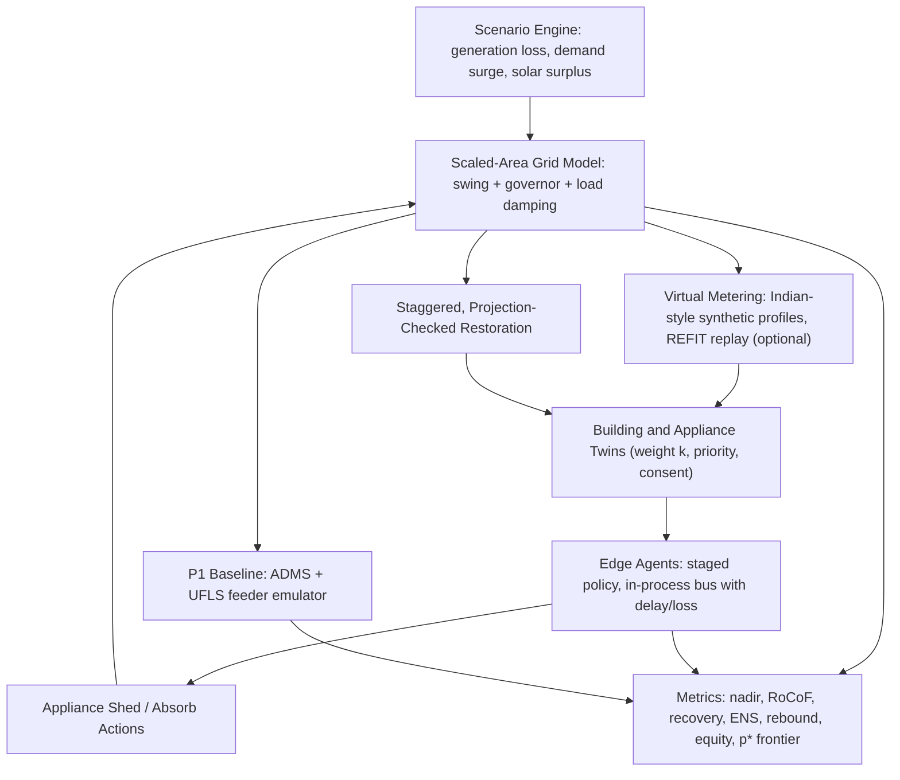

# Project Rakshak: Framework (v2, reviewed)

**Review date:** 27 Oct 2026 | **Status:** reviewed, ready for implementation | **Cost to build:** ₹0 (open-source tools only)
**Working title:** Edge-Intelligent Grid Resilience for Blackout-Free Smart Cities
**Suggested subtitle (see §3, issue 6):** *Appliance-Level, Priority-Aware Demand-Side Frequency Response for the Indian Grid: a Karnataka-Calibrated Digital Twin*

This document replaces the "what and why" parts of the Knowledge Transfer document. The KT document stays valid for everything this framework does not change (engineering practices, database layout, repository layout, testing, reproducibility). Section 2 lists what is kept.

---

## 1. Verdict

**Is the idea good enough?** Yes, with fixes. The underlying problem is real in Karnataka and in India generally: feeder-level load shedding is blunt, and the grid now sees frequency problems in both directions. But the idea as written has three weaknesses that an evaluator or a power-systems reviewer would find quickly:

1. **Physical scale is wrong.** Karnataka is part of one synchronous national grid. A neighbourhood of buildings cannot move system frequency, so "building sheds load, frequency recovers" is not true at neighbourhood scale. (Fix in §6.1.)
2. **Priority-aware shedding is not novel by itself.** Published work already ranks loads by priority inside under-frequency load shedding (UFLS). (Details in §5.)
3. **Thresholds and baselines do not match Indian practice.** The 49.6 Hz trigger and the "feeder-level" baseline need to be tied to the Indian Electricity Grid Code (IEGC) band, the Southern Region's Automatic Demand Management Scheme (ADMS) and feeder-based UFLS. (Fix in §6.3 and §6.5.)

After the changes below, the project is **novel in combination and context** (not novel in any single building block), which is an honest and defensible position.

| Dimension (my assessment) | As written | After this framework |
|---|---|---|
| Problem relevance to Karnataka/India | 7/10 | 9/10 |
| Technical soundness | 5/10 | 8/10 |
| Novelty | 3/10 | 6–7/10 |
| Feasibility at zero cost | 9/10 | 9/10 |
| Risk of over-claiming | High | Controlled (see §11) |

---

## 2. What is kept unchanged

Nothing below is redesigned, because it is already sound:

- Software-only digital twin; closed loop (disturbance → frequency → local decision → appliance state → demand → frequency).
- Three priority tiers (Critical / Essential / Deferrable) and the rule "the standard policy never deliberately sheds Critical loads".
- Appliance state machine, virtual edge agents, deterministic staggered restoration (hash of building ID, incident ID, seed).
- Reduced-order swing-equation core, configurable scenario files, fixed seeds, three-policy comparison on identical scenarios.
- Stack: Python, NumPy/SciPy, FastAPI + WebSockets, React/TypeScript, PostgreSQL, pytest, Ruff, Docker Compose.
- KT sections on database, repository layout, testing, fail-safe semantics, reproducibility, and the "smallest first milestone" idea.

---

## 3. Problems found and fixes

| # | Issue | Why it matters | Fix (minimal) |
|---|---|---|---|
| 1 | Neighbourhood cannot move interconnected-grid frequency | Core claim would be physically unsupported | **Scaled-area model** (§6.1): each simulated building represents *k* real buildings; area demand and equivalent inertia are in per-unit; add an optional *islanded microgrid* mode where the claim is physically direct |
| 2 | Single threshold 49.6 Hz shed / 50.0 Hz restore | Indian operating band is 49.90–50.05 Hz; restoring at exactly 50.0 will chatter | **Staged thresholds** (§6.3); 49.6 Hz kept as Stage 2; restoration uses a band plus hold time |
| 3 | Priority-aware UFLS already exists in literature | Cannot be the headline novelty | Headline shifts to N1–N4 (§5) |
| 4 | "Feeder-level" baseline is vague | Weak baseline = weak result | **Baseline emulates Karnataka/Southern Region ADMS + feeder UFLS** (§6.5) |
| 5 | Only under-frequency is modelled | India also has persistent *over*-frequency in solar hours | **Two-sided response** (N3) |
| 6 | "Blackout-free" in the title | Over-claim; a digital twin cannot guarantee this | Keep title for continuity, add the subtitle above, and use "blackout-risk reduction" in the report |
| 7 | NILM uses UK data (REFIT) and is on the critical path | Scope creep; UK load mix differs from Indian homes (AC, geyser, pump, inverter) | NILM becomes a **time-boxed, droppable module**. Core control uses known appliance identity from the twin. NILM only feeds the "unknown appliance" fallback. Add Indian-style synthetic load profiles |
| 8 | Tool bloat (ANDES, pandapower, Prometheus, Grafana, OpenTelemetry, Mosquitto) | Time sink, no effect on the core claim | **Dropped from the plan.** MQTT replaced by an in-process message bus with delay/loss injection (MQTT stays an optional stretch) |
| 9 | Governor/primary response only "if required" | Without it, frequency results are not credible | **Governor with droop and deadband is mandatory** (§7) |
| 10 | No statistical plan | Single runs prove little | 30 seeds per scenario, paired comparisons, confidence intervals (§9) |

---

## 4. Karnataka and Indian grid context

*"Karnataka Electricity Board" no longer exists as one body. From background knowledge (verify): it was unbundled around 2000 into **KPTCL** (transmission; its State Load Despatch Centre, SLDC, runs real-time operation) and distribution companies **BESCOM, MESCOM, HESCOM, GESCOM and CESC**. **KERC** regulates tariffs. Frequency is a national/regional matter coordinated through Grid-India's regional and national load despatch centres.*

| Fact | Used for | Status |
|---|---|---|
| IEGC 2023: reference frequency 50.000 Hz, allowable band 49.90–50.05 Hz | Normal band, recovery band | Verified via search |
| Southern Region ADMS: alarm at ≤49.9 Hz, automatic feeder tripping at ≤49.85 Hz when overdrawal persists (reported as 250 MW over 10 / 15 min); states must name feeder groups for Stage 1–3; reported as ineffective in a CERC matter involving Karnataka | Baseline policy (§6.5), motivation | Verified via search (press report of CERC proceedings); **human to confirm current settings** |
| UFLS/df/dt relays are installed on radial feeders, grouped, no overlap between groups; Southern RLDC pressed KPTCL to identify *urban* feeders for the last stage | Baseline policy, motivation (urban feeders contain critical loads) | Verified via search (older CERC record); **human to confirm against IEGC 2023 and current SR schemes** |
| IEGC 2023 generator governors: droop 3–6%, deadband not exceeding ±0.03 Hz | Governor parameters | Verified via search (Grid-India slides) |
| Frequency stayed above 50.05 Hz for 26–38% of three days in Aug 2024; 39 high-frequency days in Q3–Q4 FY25, linked to solar injection | Over-frequency mode (N3) | Verified via search |
| State grid codes in 2026 are being aligned to IEGC 2023 (e.g. Himachal, Meghalaya, Chhattisgarh draft); Himachal retains UFLS from 49.40 Hz | Illustrative UFLS stage start | Verified via search; **Karnataka's own status unknown, human to check KERC/KPTCL** |
| KERC reintroduced Time-of-Day (ToD) charges for the 6–9 am peak in FY2024-25 | Realistic flexible-load windows | Verified via search; **check current FY2026-27 slots** |
| Ministry of Power draft consumer-rights amendment (Mar 2026) proposes a demand-response framework and ToD tariffs | Regulatory hook, consent model | Verified via search as a *draft*; status unknown |

**Rule for the report:** state each of these as "as reported in [source]" and list the date you checked it. Never present a threshold as a certified Karnataka setting.

---

## 5. Novelty assessment

### 5.1 What is already published (so cannot be claimed)

- Load-priority-based UFLS: fuzzy ranking, weighted-sum ranking, mixed-integer optimisation, usually for islanded distribution networks or generic test systems.
- Feeder-allocation methods for UFLS that account for distributed generation uncertainty.
- Staggered / randomised restoration and cold-load pickup studies (general literature).
- Decentralised, frequency-triggered appliance control ("grid-friendly" / dynamic-demand appliances) (background knowledge, **verify**).
- Digital twins and dashboards for grids in general.

### 5.2 Novel contributions to claim (in combination and context)

| ID | Contribution | Type | Why it is defensible |
|---|---|---|---|
| **N1** | **ADMS-at-the-edge.** Replace feeder-level tripping (the Southern Region ADMS/UFLS pattern) with appliance-level, priority-aware, staged shedding at building edge agents, benchmarked against a faithful emulation of that baseline | Core | Uses Indian scheme structure and the reported weakness of feeder tripping. Published priority-UFLS work does not target this baseline |
| **N2** | **Participation-feasibility frontier.** Compute *p\**(disturbance size, inertia): the minimum share of demand enrolled with flexible loads so that Critical and Essential loads are never shed and feeder UFLS is never triggered | Core | Answers "how many buildings must a discom enrol?", which neither the original synopsis nor the common priority-UFLS papers answer. Cheap to compute with the twin |
| **N3** | **Two-sided frequency response.** Shed on under-frequency, *absorb* (EV charging, water heating, pre-cooling) on over-frequency in solar-surplus hours, within comfort limits and ToD windows | Core (small) | Matches the observed Indian high-frequency problem; most UFLS work is one-sided |
| **N4** | **Decentralised equity.** Credit-weighted rotation of who is curtailed, reported with Jain's index, with no inter-building communication | Extension | Fairness is rarely evaluated together with priority protection and rebound |

### 5.3 Claim wording

> "We present an open, reproducible, Karnataka-calibrated digital twin that benchmarks appliance-level priority-aware demand response against Southern-Region-style feeder tripping, quantifies the participation needed for critical-load protection, and evaluates two-sided (under- and over-frequency) response."

Do **not** write "first", "novel algorithm", or "guarantees blackout-free".

### 5.4 Human verification before claiming novelty

Spend half a day on a literature check (Google Scholar, IEEE Xplore abstracts, arXiv, all free): search "priority UFLS India", "ADMS Southern Region", "demand response over-frequency India", "participation threshold demand response frequency". If N1–N3 turn out to be covered, fall back to the "benchmark and reproducible twin" framing and keep the claims at that level.

---

## 6. Revised concept

### 6.1 Scaled-area model (fixes issue 1)

Two modes share the same code:

- **Mode A: Scaled area (default).** The area is a reduced-order equivalent of a regional grid. All quantities are per-unit of area demand. Simulated buildings are *representatives*: each has a weight *k* (real buildings represented). Enrolled share *p* = (weighted enrolled demand) / (area demand). The research question becomes "what *p* is needed", not "does one neighbourhood fix the grid". Results are **relative, not absolute MW**.
- **Mode B: Islanded microgrid.** A campus or neighbourhood islanded from the grid (inertia low, demand small). Here building-level shedding moves frequency directly. This is where the original "local" story is physically valid. Use it as a sensitivity case and for the live dashboard demo.

### 6.2 Control scope

Edge agents act only on **enrolled, consented** loads. Critical loads are designated by the consumer and are never in the shed set under the standard policy. A software policy cannot guarantee supply when generation is short (keep this sentence in the report).

### 6.3 Staged thresholds (all configurable, defaults pending human calibration)

| Stage | Trigger (default) | Action |
|---|---|---|
| S0 Advisory | f ≤ 49.90 Hz for ≥ 10 s | Soft actions on Deferrable loads (throttle EV charging, raise AC setpoint) |
| S1 | f ≤ 49.85 Hz for ≥ 5 s (matches ADMS trip level, without the 10–15 min wait) | Shed Deferrable loads |
| S2 | f ≤ 49.60 Hz (original synopsis value) or RoCoF ≤ −0.3 Hz/s | Shed Deferrable, then Essential per policy |
| S3 | f ≤ 49.40 Hz (typical first UFLS stage region, see §4) | Shed remaining Essential; Critical still protected. Feeder UFLS relays remain independent |
| O1 Absorb | f ≥ 50.05 Hz for ≥ 30 s | Permit Deferrable loads to start or increase (within comfort, ToD, and device limits) |
| O2 Absorb+ | f ≥ 50.20 Hz | Permit all enrolled flexible loads to run |

Add hysteresis, minimum on/off times, and a lockout interval against chatter.

### 6.4 Restoration (replaces the single 50.0 Hz restore point)

1. Eligible when f ≥ 49.95 Hz continuously for T_stable (default 60 s).
2. Release in order of waiting time; delay = base + (hash(building_id, incident_id, seed) mod window).
3. Before each release, check a projected post-pickup frequency (static estimate from D and the release size). Release only if the projection stays ≥ 49.90 Hz.
4. Any relapse below the stage-1 threshold freezes restoration.

### 6.5 Baselines (all on identical scenarios and seeds)

| Policy | Description |
|---|---|
| P0 Unmanaged | No demand-side action; governor only |
| P1 SR-ADMS + UFLS emulator | Feeder groups (Stage 1–3) trip at configured thresholds with delays; manual-style restoration after a hold period; groups include mixed loads including Critical |
| P2 Priority-aware edge control | §6.3 and §6.4 |
| P3 Simultaneous-restore variant of P2 | Isolates the value of staggering |

### 6.6 Architecture (delta from KT)



---

## 7. Grid model (per-unit)

```
Frequency (swing):        2H * d(dw)/dt = dPm - dPL - D * dw
                          dw = (f - f0) / f0,  f0 = 50 Hz
Governor (with deadband): Tg * d(dPg)/dt = -dPg - (1/R) * DB(dw)
Turbine:                  Tt * d(dPm)/dt = dPg - dPm
Headroom clamp:           dPm in [-down_reserve, +up_reserve]
Total demand change:      dPL = dP_disturbance + sum(appliance demand changes) 
```

Parameters and their sources:

- R (droop) = 0.05, deadband = ±0.03 Hz (within IEGC 2023 ranges).
- H: sweep 3–6 s (default 4 s) as sensitivity; **human to justify** against published Indian grid inertia estimates.
- D: sweep 1–2 (per-unit load damping); **human to justify**.
- Tg, Tt, reserves: document in `docs/assumptions.md`; sweep in E5.
- Numerical method: RK4 at 20 ms; agents sample at 100 ms–1 s with 0.1–2 s configurable communication delay; dashboard refresh independent.

Validation tests from KT §6 stay unchanged (no disturbance, direction of response, shedding effect, step convergence). Add: governor deadband behaviour, and headroom saturation.

**Calibration (free):** download public Grid-India daily frequency/demand reports and SLDC Karnataka data (human task) to sanity-check frequency profiles, nadir ranges and band occupancy. Calibration is qualitative, not a validation claim.

---

## 8. Appliances and loads

Tiers stay as in KT §7. Add an **Indian-style synthetic load library** (configurable): split-AC (compressor cycling), geyser/water heater, EV charger (2-wheeler and car), ceiling fans, refrigerator (critical option), water pump, lighting, inverter-backed loads, medical device (critical). Each has rated power, duty cycle, minimum on/off times and comfort constraint (e.g. maximum continuous shed minutes for AC and geyser).

REFIT (UK, CC BY 4.0, 8-second data) stays as an optional replay source for realism of aggregate shape only. Keep empirical (REFIT) and synthetic results separate in all reports.

State machine, shed eligibility and "state change must change simulated demand" rules are unchanged from KT §7.

---

## 9. Evaluation

### 9.1 Metrics

KT §14 metrics stay (nadir, RoCoF, recovery time, shed latency, critical energy not served, rebound peak, NILM metrics). Add:

| Metric | Purpose |
|---|---|
| Feeder trips avoided (vs P1) | Headline for N1 |
| Energy curtailed by tier (kWh) and number of switch cycles per appliance | Service cost and device wear |
| Comfort violation minutes (AC, geyser, EV charge completion) | Consumer impact |
| Jain's fairness index over cumulative curtailment | N4 |
| Over-frequency excursion time above 50.05 Hz and absorbed energy | N3 |
| p\* frontier (minimum p meeting criteria) | N2 |

### 9.2 Experiment matrix

| ID | Question |
|---|---|
| E1 | Unmanaged baseline severity (P0) |
| E2 | Feeder-level ADMS/UFLS emulation consequences (P1) |
| E3 | Priority-aware edge control vs P0 and P1 (P2) |
| E4 | Staggered vs simultaneous restoration (P2 vs P3) |
| E5 | Sensitivity: H, D, droop, reserves, load mix, disturbance size/duration |
| E6 | Participation frontier p\* and scalability in number of buildings/agents (N2) |
| E7 | Communication faults: delay, loss, duplication, out-of-order messages |
| E8 | Two-sided response in solar-surplus scenarios (N3) |

Do not assume P2 wins everywhere. Report trade-offs.

### 9.3 Statistics

30 seeds per scenario, identical seeds across policies, paired differences with 95% confidence intervals, and plots of full trajectories (not just summary numbers).

---

## 10. Open-source stack (zero cost)

| Layer | Tool | Change vs KT |
|---|---|---|
| Language, numerics | Python, NumPy, SciPy, Pandas | none |
| Config/schemas | Pydantic, YAML | made explicit |
| API, live updates | FastAPI, WebSockets | none |
| Frontend | React, TypeScript, Vite, Tailwind, Chart.js | none |
| Database | PostgreSQL (Docker), SQLModel or SQLAlchemy | none |
| NILM (optional) | scikit-learn | made droppable |
| Tests, quality | pytest, Ruff | none |
| Containers | Docker Compose | none |
| CI | GitHub Actions free tier (public repo) | added (free) |
| Messaging | In-process bus with fault injection | MQTT/Mosquitto demoted to stretch |
| Dropped | ANDES, pandapower, Prometheus, Grafana, OpenTelemetry | removed from plan |

Everything runs locally. Check each library's licence when finalising the repository. AI tooling (Antigravity) is a development aid, not a runtime dependency; the project must build and run without it.

---

## 11. Claim boundaries and limitations

**You may claim:** the twin reproduces expected frequency directions under documented assumptions; priority-aware edge control reduces feeder trips and critical energy not served relative to the emulated baseline *in the modelled scenarios*; the participation frontier p\* under stated parameters; two-sided response behaviour in the model.

**You may not claim:** real-world Karnataka performance; certification or utility-grade protection; that shedding cannot fail; that thresholds are KPTCL/SLDC settings; that synthetic NILM accuracy transfers to real appliances; that absolute MW results apply to a real grid (Mode A is per-unit and relative).

Known limitations to state: reduced-order single-area frequency model (no network, voltage or inter-area oscillations); simplified governor and reserves; synthetic load behaviour; consumer behaviour and consent not modelled beyond opt-in rules; cyber-security out of scope.

---

## 12. Risks

| Risk | Mitigation |
|---|---|
| Literature check shows N1–N3 already covered | Fall back to the benchmark/reproducibility framing; keep N2 (participation frontier) as the main analytic result |
| Reviewer says "one neighbourhood can't move the grid" | Mode A/B split and the explicit p\* framing (§6.1) |
| Parameters (H, D, thresholds) challenged | Sensitivity analysis E5; cite sources; present as configurable assumptions |
| Scope creep | Phase 1 is a complete research deliverable on its own (see `implementation.md`); NILM, equity and MQTT are droppable |
| AI-generated physics or citation errors | Human review gates, independent numerical checks, no unverified citations |

---

## 13. Sources (checked 27 Oct 2026)

- Mercom India, "High Grid Frequency Events Prompt Grid India to Warn Users to be Cautious" (IEGC 2023 band, Aug 2024 high-frequency days): https://www.mercomindia.com/high-grid-frequency-events-prompt-grid-india-to-warn-users-to-be-cautious
- Mercom India, "Operators Struggle to Balance Solar with Thermal Power as Grid Woes Rise": https://mercomindia.com/operators-struggle-to-balance-solar-with-thermal-power-as-grid-woes-rise
- Mercom India, CERC on overdrawal and ADMS in the Southern Region: https://mercomindia.com/cerc-directs-maintain-grid-stability
- CERC record of proceedings (UFR/df/dt relays, feeder groups, KPTCL urban feeders): https://cercind.gov.in/2013/ROP/ROP263.pdf
- Grid-India presentation (governor droop 3–6%, deadband ±0.03 Hz under IEGC 2023): https://irade.org/presentation-21-22nd-Nov2024/Grid%20stability%20and%20balancing%20due%20to%20Intermittent%20Generation_Alok%20Pratap.pdf
- Power Peak Digest, Himachal Grid Code 2026 (UFLS from 49.40 Hz; alignment with IEGC 2023): https://powerpeakdigest.com/hperc-notifies-grid-code-2026-iegc-2023/
- Deccan Herald, KERC tariff order with ToD for 6–9 am: https://deccanherald.com/india/karnataka/karnataka-power-panel-slashes-tariffs-2914773
- EI News / Energetica India, MoP draft Consumer Rights Amendment Rules 2026: https://www.energetica-india.net/news/mop-releases-draft-electricity-consumer-rights-rules-2026-proposes-demand-response-tod-tariffs
- Priority-aware UFLS prior art: Laghari et al., IJACSA 2018 (TS-fuzzy + flexible load priority): https://osuva.uwasa.fi/handle/10024/8139 ; Rosli et al., Energies 2023 (BAOA + weighted sum with load priority): https://ideas.repec.org/a/gam/jeners/v16y2023i13p5144-d1186129.html ; Sarwar, MILP-based UFLS with priority, UM 2020: https://knova.um.edu.my/student_works_2020s/513
- UFLS feeder allocation under DG uncertainty (arXiv 2211.02953): https://arxiv.org/pdf/2211.02953
