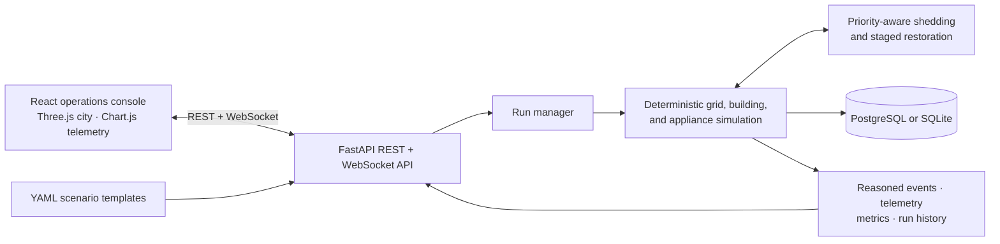

# BlackoutFree — City Grid Resilience Digital Twin

BlackoutFree is an open-source simulation and operations console for exploring
how priority-aware load shedding and staged restoration can protect critical
city services during grid stress. Scenario profiles use explicit assumptions;
the model is not validated against live utility data and does not control a
physical grid. No paid API, service, or key is required.

## Architecture



## Screenshots

> **Screenshot placeholder — Operations:** capture the desktop control-room view after final deployment verification.
>
> **Screenshot placeholder — Responsive layout:** capture the tablet/mobile operator view.

## Getting started

### Prerequisites

- Python 3.10 or newer
- Node.js 20 (npm is included)
- Docker Desktop or another Docker Compose implementation for the one-command container setup

### Docker Compose (recommended)

From the project directory (`gridshield\`) in PowerShell, with the Docker
engine running:

```powershell
docker compose up --build
```

Compose defines PostgreSQL, the FastAPI backend, and the frontend. It reads
the committed `.env.example` defaults; copy that file to `.env` only when you
need local overrides.

Open [http://localhost:3000](http://localhost:3000) for the dashboard and
[http://localhost:8080/docs](http://localhost:8080/docs) for the API.
The saved E1-E4 experiment summary is mounted read-only for the results view.

### Run services directly

For a local SQLite run without Docker, use two PowerShell terminals. If your
current directory is the repository root, start the backend in the first
terminal:

```powershell
Set-Location .\gridshield\backend
python -m pip install -e ".[dev]"
python -m uvicorn app.main:app --host 127.0.0.1 --port 8080
```

In a second terminal, start the frontend:

```powershell
Set-Location .\gridshield\frontend
npm ci
npm run dev -- --host 127.0.0.1 --port 3000
```

The backend defaults to SQLite when no `DATABASE_URL` is set. Open
[http://localhost:3000](http://localhost:3000) for the dashboard and
[http://localhost:8080/docs](http://localhost:8080/docs) for the API. To use
PostgreSQL, start the Compose `postgres` service and configure the backend
connection string. Do not commit local `.env` values.

## How decisions are made

The simulation applies a seeded disturbance to a reduced-order grid-frequency
model and evaluates the selected control policy. P0 leaves demand unmanaged;
P1 emulates feeder-stage response; P2 uses appliance priorities to shed
lower-priority demand while protecting critical loads where feasible. P2
restoration is stability- and capacity-gated; both modes restore one eligible
appliance per control tick, with deterministic stagger delays in the standard
P2 mode. Frequency projection and available generation headroom must both
permit each pickup; P3 disables restoration. Shed and restore events include a
short decision reason. These are model decisions, not guaranteed protections
for a real grid.

## Dashboard demonstration

1. Start the services and open the dashboard. The API indicator turns green
   only after `/health` responds; scenario choices are loaded from backend YAML.
2. Select a scenario and one of `P0_unmanaged`, `P1_adms_feeder`,
   `P2_priority_edge`, `P2_priority_edge_synchronized`, or
   `P3_priority_edge_no_restoration`, then start a run. The two P2 modes use
   staggered or immediate progressive restoration; P3 disables restoration.
3. Tune the disturbance, recovery ramp, inertia, governor response, protection
   thresholds and hold times, edge mode, communication-loss probability, and
   playback speed before launching a run. Pause, resume, or stop an active
   simulation from Run controls.
4. Inspect the isometric neighborhood, animated feeder-flow illustration,
   frequency samples, appliance states, event timeline, metrics, and the
   **Resilience systems** view for the selected run inspector, edge-agent,
   restoration, NILM, medical-load, feeder, and HIL diagnostics. The inspector
   uses the saved backend run configuration alongside live telemetry and
   building state. The scene uses scenario building IDs and live appliance
   state from the active backend run.
5. Use **Compare four control modes** to compare P0, P1, staggered P2, and
   synchronized P2 over paired deterministic seeds (3 by default, configurable
   up to 10). P3 remains available for individual runs; review frequency
   trajectories and multi-seed summaries in **Results & history**.
6. Open **Results & history** for the saved experiment summary or a persisted
   run. Saved results are clearly separated from the currently selected run.

### City model and visual state

The streetscape is a procedural visualization, not a geographic or electrical
network model. Building IDs map to fixed visual archetypes; appliance snapshots
drive window lighting, appliance indicators, demand bars, and status markers.
Before a run, the selected scenario supplies the initial appliance states. Once
available, the active run's backend building snapshots replace those initial
states. Selection and labels are also available through the keyboard-accessible
building list. Shipped scenarios contain 12 distinct simulation-backed 3D
assets, including a clinic with critical medical loads. Residential `weight_k`
values represent 500 household-equivalents across those assets; commercial,
school, and clinic sites are additional modeled entities. The scene renders and
allows selection of all 12 representative assets, while each asset's power
snapshots scale to the number of dwellings it represents.

Feeder pulses use an assumption-based balanced three-phase current estimate
from modeled branch kW (400 V line voltage and 0.95 power factor). This helps
visualize relative demand changes but is not measured current, a solved
load-flow, voltage-drop calculation, or a physical feeder network. Pausing and
playback speed affect the active run; the current simulation is still a
reduced-order single-area model.

The optional HIL panel accepts a serial port and target building for a P2 run.
Its status is only reported as connected after a valid controller heartbeat;
without serial hardware the simulation remains in software-only mode. NILM
load-step estimates are derived from simulated per-building aggregate power,
are explicitly labeled as estimates, and do not modify appliance state.

The active building snapshot and diagnostic samples are held in the backend
process; after a backend restart, historical run records and telemetry remain
available from the database, but live appliance, restoration, edge, and NILM
diagnostics may not. NILM estimates and their evaluation compare synthetic
aggregate-load transitions with the same simulated twin state; they are not
validated against independent meter data. Missing recovery-time data is shown
as unavailable, not zero. Curtailment and critical-energy metrics integrate
configured appliance power over shed-to-restore or shed-to-run-end intervals.

Telemetry reports total generation as baseline generation plus governor
response and signed generation disturbance; demand includes appliance-load
changes and signed exogenous demand disturbance. The two disturbance components
are also exposed separately. A solar cloud dip is the selected PV output
reduction fraction multiplied by the scenario's solar share. Medical-device
interruption is summed in device-seconds; backup supply is not modeled.
Communication packet loss is supported in active runs. Delay, duplication, and
reordering settings are rejected until those fault behaviors are wired into the
simulation.

### Troubleshooting

- If the dashboard says the API is offline, confirm `http://localhost:8080/health`
  responds and that the backend and frontend use the same host and port.
- If port 8080 is occupied, start Uvicorn on another port and set
  `VITE_API_BASE_URL` to that same browser-accessible URL. For Compose, change
  the backend host-port mapping and the frontend API URL together.
- If PostgreSQL does not start, wait for the Compose health check or inspect
  `docker compose logs postgres backend`; the backend waits for PostgreSQL.
- If scenario choices do not load, inspect backend logs for invalid YAML under
  `backend\data\scenarios`. The dashboard does not substitute sample scenarios.

## Verification commands

```powershell
Set-Location .\backend
python -m pytest -q
python -m ruff check .
Set-Location ..\frontend
npm ci
npm test
npm run check
npm run build
```

```powershell
Set-Location .\frontend
npx playwright install chromium
npm run test:e2e
```

Install Playwright's Chromium browser once before the browser test. The E2E
command starts an isolated backend, builds and serves the production frontend,
and verifies scenario start, live telemetry and decision reasons, run controls,
and stop behavior. It uses ports 8001 and 3001 by default. Override them in
PowerShell if either port is occupied:

```powershell
$env:GRIDSHIELD_E2E_API_ORIGIN = "http://127.0.0.1:8002"
$env:GRIDSHIELD_E2E_FRONTEND_ORIGIN = "http://127.0.0.1:3002"
npm run test:e2e
```

## Running experiments

From `gridshield\` in PowerShell:

```powershell
Set-Location .\backend
python ..\experiments\baseline\run_e1_e4.py
```

This regenerates and overwrites `experiments\baseline\results_e1_e4.json`.

Additional appliance, restoration, fleet, NILM, and software-HIL experiments
are described in [docs/experiment_protocol.md](./docs/experiment_protocol.md).
The serial adapter is optional (`python -m pip install -e ".[hil]"`); a P2 run
can include `hil_port`, `hil_building_id`, and optional `hil_baud_rate` in its
API request to attach one controller. Normal simulation does not require an
ESP32 or serial port. Appliance startup and lockout defaults are illustrative
assumptions, not measured Karnataka data.

## Claim boundaries

**You may claim:** the twin reproduces expected frequency directions under documented assumptions; priority-aware edge control reduces feeder trips and critical energy not served relative to the emulated baseline *in the modelled scenarios*; the participation frontier p* under stated parameters; two-sided response behaviour in the model.

**You may not claim:** real-world Karnataka performance; certification or utility-grade protection; that shedding cannot fail; that thresholds are KPTCL/SLDC settings; that absolute MW results apply to a real grid.

## Known limitations

- Reduced-order single-area frequency model (no network, voltage, or inter-area oscillations).
- Simplified governor; synthetic load behaviour.
- Consumer behaviour beyond opt-in rules not modelled.
- Cyber-security out of scope.

## Project documents

- [Audit and feature decisions](./docs/AUDIT.md)
- [Implementation plan and phase record](./docs/PLAN.md)
- [Interface design tokens and layout](./docs/DESIGN.md)
- [Verification evidence and limits](./docs/VERIFICATION.md)
- [Architecture details](./docs/architecture.md)

## Stack

Python · NumPy/SciPy · FastAPI · WebSockets · React/TypeScript · Three.js · PostgreSQL/SQLite · Docker Compose

## Sources

- IEGC 2023 frequency-band context: https://www.mercomindia.com/high-grid-frequency-events-prompt-grid-india-to-warn-users-to-be-cautious
- Governor droop/deadband context: https://irade.org/presentation-21-22nd-Nov2024/Grid%20stability%20and%20balancing%20due%20to%20Intermittent%20Generation_Alok%20Pratap.pdf
- CERC / Southern Region ADMS context: https://cercind.gov.in/2013/ROP/ROP263.pdf
- Himachal Grid Code / UFLS context: https://powerpeakdigest.com/hperc-notifies-grid-code-2026-iegc-2023/

These references provide research context only; they do not establish model
calibration, regulatory compliance, or real-grid validation.
