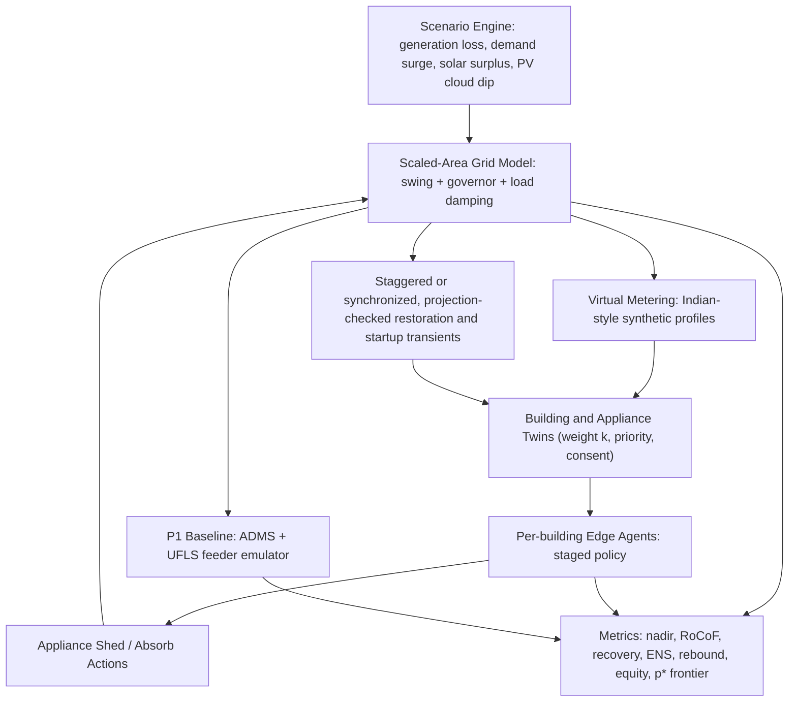
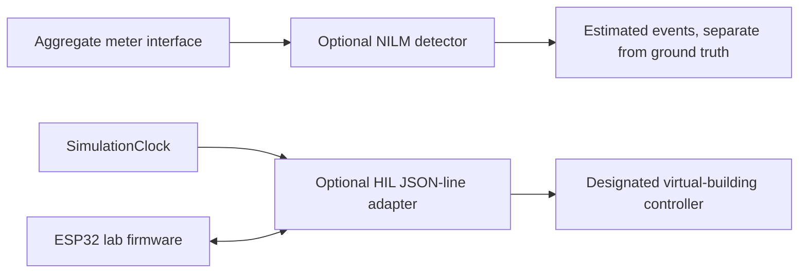

# BlackoutFree — Architecture

## System overview

BlackoutFree is a software-only digital twin that models grid-frequency disturbances
and evaluates priority-aware demand-side response. The core loop is:

**Disturbance components → Frequency response → Edge agents → Appliance switching → Demand delta → Frequency**

## Component diagram

## Two area modes

- **Mode A (scaled):** Each building twin represents k real buildings. Quantities are per-unit of area demand. Research question: what participation fraction p* is needed?
- **Mode B (islanded):** Campus/neighbourhood islanded from the grid. Building-level shedding directly moves frequency. Valid for live demo and sensitivity cases.

## Policies

| Policy | Description |
|--------|-------------|
| P0 Unmanaged | No demand-side action; governor only |
| P1 ADMS Feeder | Emulates Southern Region feeder tripping; no priority awareness |
| P2 Priority Edge | Appliance-level staged shedding; Critical loads never deliberately shed |
| P2 Synchronized | Priority-aware shedding with safety-gated batch restoration |
| P3 No Restoration | Priority-aware shedding with restoration disabled |

## Data flow

1. `SimulationClock` advances the existing RK4 model at the scenario integration step.
2. The active P2 policy is invoked at `AGENT_SAMPLE_INTERVAL_S`; P1 and P2 timers use the same interval.
3. Appliance state transitions apply minimum ON/OFF times and compressor-specific
   lockout; restart demand is a time-varying transient.
4. The clock sums per-step appliance power changes weighted by each building's
   `weight_k`, then feeds the normalized delta into `GridModel.step()`.
5. `TelemetrySample` is pushed at `WS_PUSH_INTERVAL_S` and buffered for DB.

Agent and WebSocket intervals must be integer multiples of the grid integration
step, and policy timers must match the configured agent interval. Telemetry
separates signed generation and demand disturbances. Total generation includes
governor response; total demand includes appliance switching and exogenous
demand changes.

The in-process fault-injection bus remains a separate component and is not
wired into live runs. The active loop uses seeded packet loss from scenario
configuration for edge connectivity; delay, duplication, and reordering do not
currently affect run decisions and are rejected by scenario validation.

REST inputs and outputs use Pydantic schemas, reject unknown request fields,
and report failures in a consistent `{ "error": { "code", "message" } }`
envelope (validation errors also include field-level details). The dashboard
surfaces that message and distinguishes backend connectivity failures.

Optional components are separate from the deterministic simulation core:

NILM estimates are derived from simulated aggregate load, do not mutate
ground-truth appliances, and are labeled as estimates in the live dashboard.
The HIL adapter can be enabled for one configured
building on a P2 run through the optional serial fields on the run-start API;
heartbeat loss returns control to the GridShield policy. The simulation remains
usable without either optional component.
